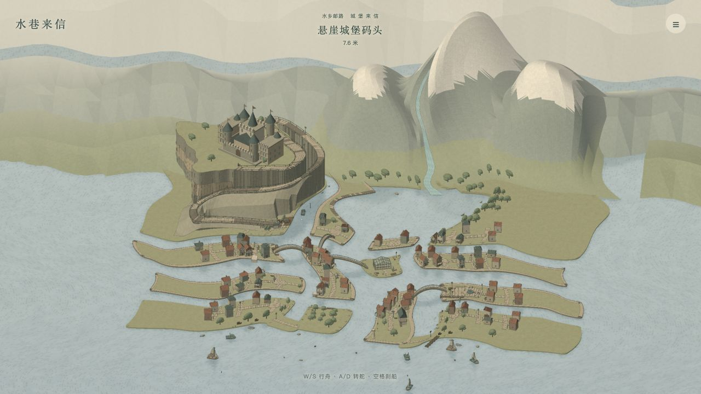

# 水巷来信 · Harbor Post

手绘风格的欧洲水乡送信游戏。驾驶小船穿行运河、湖泊和海湾，靠岸投递五封信；也可以在悬崖码头换乘马车，沿山路到城堡送信。

场景采用 **Blender 建模 → GLB 导出 → Three.js 加载 → 统一手绘渲染**。游戏可直接部署到静态托管，无需服务器或构建步骤。


## 本地运行

```sh
python3 -m http.server 8765 --bind 127.0.0.1 --directory dist
```

打开 http://127.0.0.1:8765/ 。网页和模型均随仓库提供，无需安装 npm 依赖或运行 Blender。

- W / S：前进与倒船；A / D：转舵；空格：刹船。
- E：靠岸送信、换乘马车或返回小船；马车沿山路行驶。
- Esc：菜单；M：河道图；滚轮：调整视野。
- 菜单可调船速（默认 1.5×，范围 0.75～2.5×）、跟随/全景、日光/夜晚、晴天/雨天、声音和任务追踪。
- 访问 `/?route=castle` 可从悬崖码头开始体验；原邮路进度单独保存在当前浏览器。

## 部署到 Cloudflare Pages

在 Cloudflare 创建 **Pages** 项目并连接 `YHWmz/harbor-post`，设置：

| 项目 | 值 |
| --- | --- |
| 生产分支 | `main` |
| 根目录 | 仓库根目录（留空） |
| 框架预设 | `None` |
| 构建命令 | `exit 0` |
| 构建输出目录 | `dist` |
| 环境变量 | 无需设置 |

部署只使用 `dist/`。Blender、源素材和测试无需在 Cloudflare 上执行。这里提供的是 Pages 部署方式；本次上传不会创建或部署 Cloudflare 项目。

参考：[Cloudflare 静态 HTML 指南](https://developers.cloudflare.com/pages/framework-guides/deploy-anything/)、[构建设置](https://developers.cloudflare.com/pages/configuration/build-configuration/)。

## 当前场景

- 弯曲且宽窄不同的运河、山后湖泊、主入海口与海滨码头。
- 70 栋六种轮廓的住宅、城市道路、喷泉中心广场、集市与树木。
- 左上方悬崖城堡，229 米可往返的马车山路。
- 三座贴湖近山与雪线附近约42米高的融水源，溪流沿真实山谷汇入湖泊；雪山远景、太阳、月亮、云和雨天。
- 27 盏沿街及山路路灯，夜晚暖光与亮窗；流动水面和场景倒影。
- 8 艘泊岸帆船/渔船、水上装饰和 12 处有碰撞的浅滩石头。
- 原先确认的 Blender v5 邮船、码头及地标继续复用。



## 文件结构

```text
dist/             可直接发布的网页、Three.js、GLB 与许可文件
tests/            航路、碰撞、马车和本次场景优化验证
tools/            可移植的 Blender Python 构建脚本
blender/          当前城镇、马车、山景和原 v5 可编辑源文件
source-assets/    实际复用的 Kenney CC0 原始 GLB 组件与许可证
docs/             预览截图
ART_DIRECTION.md  美术方向
asset-audit.json  场景网格和导航导出审计
```

## 验证

安装 Node.js 后，在仓库根目录运行：

```sh
node tests/navigation.mjs
node tests/carriage.mjs
node tests/town-upgrade.mjs
python3 tests/alpine-terrain.py
```

覆盖全部五封信、返航、城堡码头、湖泊、河口、海滨及近海的实际驾驶，最高船速碰撞，229 米马车上下山和建筑净空，以及河口封闭、原生灯位、广场、住宅和山泉坡度。主城镇导出为 218,610 个三角面、26 个材质，限制为 220,000 个三角面。

## 修改与重建模型

使用 Blender 4.5 LTS，`blender` 命令需在 PATH 中，或替换为本机 Blender 可执行文件路径：

```sh
blender -b --python tools/build_european_town.py
blender -b --python tools/build_painted_hills.py
blender -b --python tools/build_carriage.py
```

脚本相对仓库根目录解析路径，可在其他电脑运行。主城镇脚本读取 `blender/harbor_expanded_v5.blend`、`source-assets/` 和已有的 approved GLB 模块，输出到 `blender/` 与 `dist/assets/`，同时更新 `dist/world.mjs` 的导航数据。不要只在 Three.js 中修改可见岸线而不更新碰撞；也不要手动修改生成的 `world.mjs` 地形数据。

Blender 负责建筑、地形、车辆和碰撞的真实网格；Three.js 负责纸纹、墨线、水面反射、天气、光照与游戏逻辑。

## 第三方素材

- [Kenney Fantasy Town Kit](https://kenney.nl/assets/fantasy-town-kit)：CC0，原始许可随 `source-assets/fantasy-town/` 和 `dist/assets/` 提供。
- [Kenney Watercraft Kit](https://kenney.nl/assets/watercraft-kit)：CC0，原始许可随 `source-assets/watercraft/` 和 `dist/assets/` 提供。
- Three.js：MIT，见 `dist/vendor/THREE-LICENSE.txt`。

公开组件在 Blender 中统一为纸色材质并按材质合并；使用清单见 `dist/assets/public-assets.json`。未使用参考视频作者的模型。

## 版本与湖岸近山优化

[`v1`](https://github.com/YHWmz/harbor-post/tree/v1) 固定保存提交 `6ce44e9` 的完整版本，后续优化在 `main` 继续，避免覆盖 v1。

湖泊北岸新增三座36～55米的近山；约42米高的雪线融水顺着弯曲山谷流下。`tools/alpine_terrain.py` 同时定义山体、溪床、雪线和水源，导出的水面与山谷网格逐段对齐，移除了旧版直立石槽。山景共10,204个三角面，主城镇218,610个三角面；全景取景已纳入完整近山轮廓。新增 Python 检查直接读取山景 GLB，确认溪床高度和水面贴合。
